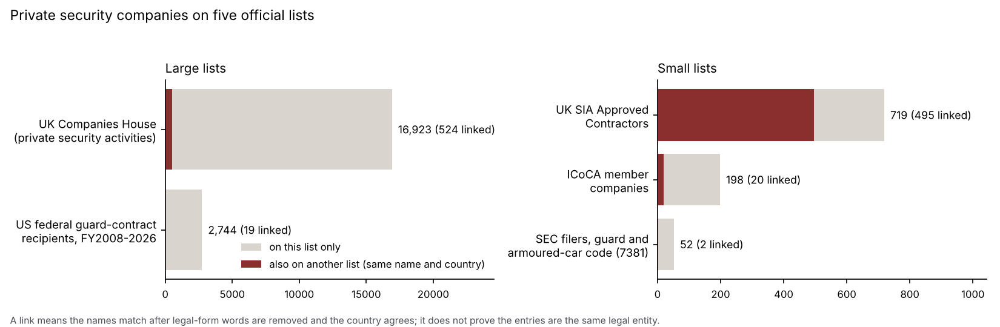

# security-company-registers

Published by [Mercenomics](https://mercenomics.org), an independent data archive on the business of force for hire.

A directory of private security companies built only from official lists. It records which list each company is on, with the list's own identifier, status and dates, and marks the companies that appear on more than one list. It uses five lists:

| List | Who keeps it | What being on it means | Entries |
|---|---|---|---|
| ICoCA member companies | International Code of Conduct Association (Geneva) | The company has joined the association that oversees the International Code of Conduct for Private Security Service Providers, as a certified member, member or affiliate | 198 |
| SIA Approved Contractors | UK Security Industry Authority | The company has met the standards of the UK's voluntary Approved Contractor Scheme for the sectors listed | 719 |
| Companies House, SIC 80100 | UK Companies House | A live UK company that gives "private security activities" as one of its activity codes | 16,923 |
| SEC, SIC 7381 | US Securities and Exchange Commission | A company that files with the SEC under the code "Services-Detective, Guard & Armored Car Services" | 52 |
| US federal guard contracts | USAspending.gov, via the Mercenomics dataset [us-guard-spending](https://doi.org/10.5281/zenodo.23750993) | The company received a US federal guard-service contract (product and service code S206), fiscal years 2008 to 2026 | 2,744 |



## What it shows

- **20,636 entries in all.** Most are small UK companies: 16,923 live UK companies give private security as an activity, out of 5,704,712 live companies on the register. Two thirds of them (11,246) were incorporated in 2020 or later, and 2,254 had a proposal to strike them off the register.
- **The ICoCA list is small and mostly outside the West.** Of 198 member companies, 113 are certified members, 21 members and 64 affiliates. The most common headquarters are Iraq (42), the United Kingdom (16), Somalia (11), Nigeria (10) and the United States (9).
- **The lists rarely overlap**, except in the UK. 523 names appear on more than one list in the same country:
  - 495 of the 719 SIA Approved Contractors have the same name as a UK company coded for private security.
  - 20 of the 198 ICoCA members match another list, including 10 that also hold US guard contracts under the same name (among them Triple Canopy, SOC, Michael Stapleton Associates and Erinys Iraq).
  - Only 19 of the 2,744 US guard-contract recipients match another list.

## Things to know before using it

- **Each list measures something different.**
  - Being on a list is a fact about that list: ICoCA membership, an SIA approval, an activity code a company chose for itself, an SEC filing code, a contract.
  - A company that chose activity code 80100 may never have traded.
  - Many security companies are on none of these lists.
- **A link means the names match, not that the companies are proven to be the same.** Entries are linked when two things hold:
  - their names are the same after legal-form words (Limited, Ltd, LLC, Inc. ...), "The", bracketed notes, punctuation and case are removed;
  - and they are in the same country.

  Generic names such as "Security Services" are never linked. Every link is listed in `cross_listed.csv` so it can be checked.
  - For the 497 SIA-Companies House links, the postcode districts also agree in 380 (76%). The others may be the same company with a trading address that differs from its registered office, or different companies with the same name.
  - Companies whose names differ between lists, for example a parent and its subsidiary, are not linked.
- **Not every US guard-contract recipient is a security company.** Product and service code S206 covers any contract for guard services, so facilities-management firms and prison operators appear too. Names are as the government records them. Recipients without a Unique Entity ID are listed once per name.
- **The SEC list is small and dated.** EDGAR, the SEC's filing system, assigns one industry code per filer. Several of the 52 are alarm, lock, camera or armoured-car companies, and most stopped filing years ago; the `status` column gives each one's latest filing date. One filer registered under a person's name, not a company, is left out.
- **ICoCA's headquarters country is as ICoCA records it**, and is used for linking. A member registered in the UK but headquartered elsewhere is not linked to Companies House.
- **No personal details.**
  - The directory contains company information only.
  - UK locations are given as post town and postcode district (the first half of the postcode). Street addresses and telephone numbers from the registers are not stored.
  - Where a Companies House town field holds street details instead of a town, it is left blank.
- **The lists are snapshots,** taken on 29 October 2026; the Companies House file is the monthly snapshot of 1 October 2026. One SIA contractor's entry page (Pro Security Group Ltd, reference SSGLTDSC01) returned a server error, so its postcode is missing. Its register entry is included.

## What it cannot be used to say

- It cannot say how many private security companies a country has. The lists cover different things, and most countries have no list here.
- It cannot show that a company is reputable or compliant. ICoCA membership and SIA approval are voluntary schemes with their own standards. Companies House and SEC codes are chosen by the companies themselves.
- It cannot show that a company not on a list is unlicensed or unregulated.
- A name match cannot be taken as proof that two entries are the same legal entity.

## The data

| File | Contents |
|---|---|
| [`data/clean/directory.csv`](data/clean/directory.csv) | One row per company per list (20,636 rows) |
| [`data/clean/cross_listed.csv`](data/clean/cross_listed.csv) | Every link: the entries that share a name key and country across lists (523 groups, 1,067 rows) |
| [`data/clean/check_report.md`](data/clean/check_report.md) | Results of the checks |

Columns of `directory.csv`:

| Column | Meaning |
|---|---|
| `list` | `ICoCA`, `SIA Approved Contractor`, `Companies House SIC 80100`, `SEC SIC 7381` or `US federal guard contracts` |
| `list_id` | The list's own identifier: ICoCA member ID, SIA ACS reference, Companies House company number, SEC CIK, or the US Unique Entity ID |
| `name` | The name as the list gives it |
| `trading_name` | SIA: the trading name after "t/a"; US contracts: other names recorded for the same entity ID |
| `country` | ICoCA: headquarters country; SIA and Companies House: United Kingdom; SEC: from the business address; US contracts: the recipient's country codes |
| `place` | UK: post town and postcode district; SEC: city and state; otherwise blank |
| `status` | ICoCA membership category; SIA approval end date; Companies House company status; SEC latest filing date; US last fiscal year with a contract action |
| `since` | ICoCA joining date; Companies House incorporation date; US first fiscal year with a contract action |
| `detail` | ICoCA service type and certification; SIA approved sectors; Companies House activity codes and company type; SEC tickers and latest annual report; US guard-contract obligations, awards and parent company |
| `source_url` | Where the entry can be seen |
| `name_key` | The name used for linking |
| `country_codes` | The country as ISO 3166 three-letter codes, used for linking |
| `also_on` | The other lists on which the same name key appears in the same country |

## How it was made

1. `code/01_download.py` downloads the five lists. Only companies are kept: ICoCA's list also includes governments, civil society groups and observers, which are left out. For Companies House, all 5.7 million live companies are read and only those coded 80100 are kept.
2. `code/02_build.py` puts them into one table.
3. `code/03_link.py` makes the name keys and links.
4. `code/04_check.py` runs the checks.
5. `code/05_figure.py` draws the figure.

## How the numbers were checked

Run by [`code/04_check.py`](code/04_check.py); results in [`data/clean/check_report.md`](data/clean/check_report.md), all passing:

- every record of every source is in the directory once, and no identifier appears twice within a list;
- for all 718 SIA entry pages read, the approval end date matches the register list;
- every SEC company's own filing record gives code 7381, and every Companies House company kept has code 80100;
- the US guard-contract recipients add up to us-guard-spending's total, less its two placeholder entries, to $0.1 million;
- no telephone numbers appear, and UK locations follow the town-and-district pattern;
- every link joins entries with the same name key and country.

## Reproduce it

Needs Python 3.

```
pip install -r requirements.txt
python code/01_download.py   # downloads about 470 MB from Companies House; takes about 15 minutes
python code/02_build.py
python code/03_link.py
python code/04_check.py
python code/05_figure.py
```

The lists change daily, so a new download will give slightly different numbers. The Companies House source files (about 470 MB) are not stored. The rows used are kept in `data/raw/companies_house/`, with each source file's SHA-256 fingerprint in `data/raw/download_log.json`.

## Sources and license

Sources, download dates and terms are in [`data/README.md`](data/README.md). Code: MIT (see [`LICENSE`](LICENSE)). The clean dataset: CC BY 4.0. The source lists keep their own terms.

## Cite

See [`CITATION.cff`](CITATION.cff).
